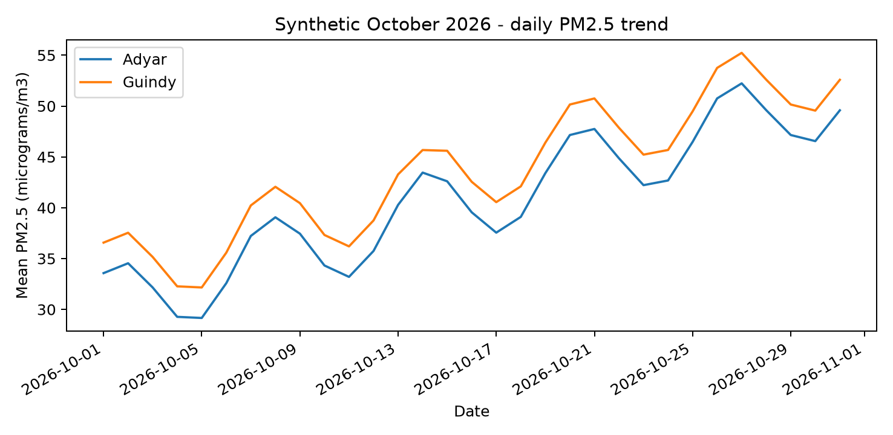
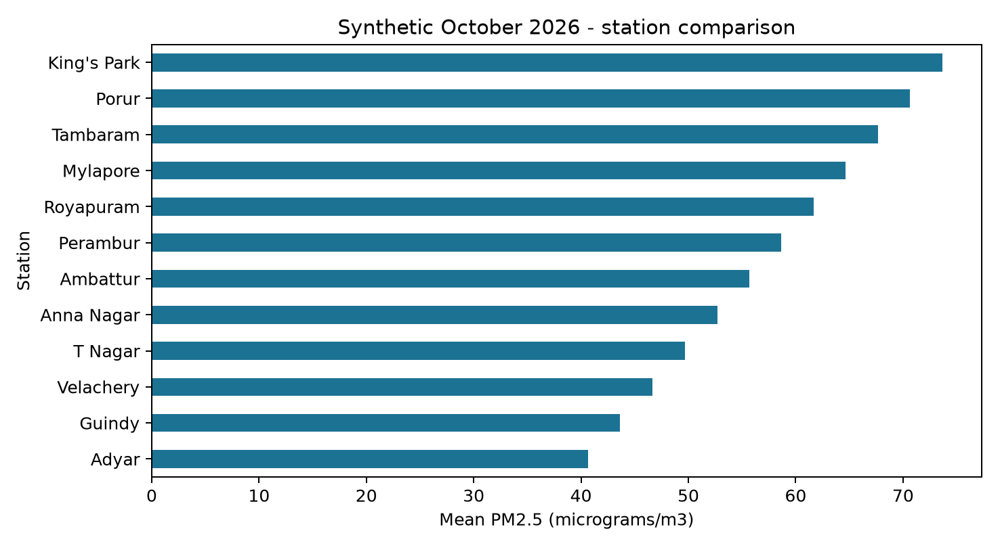
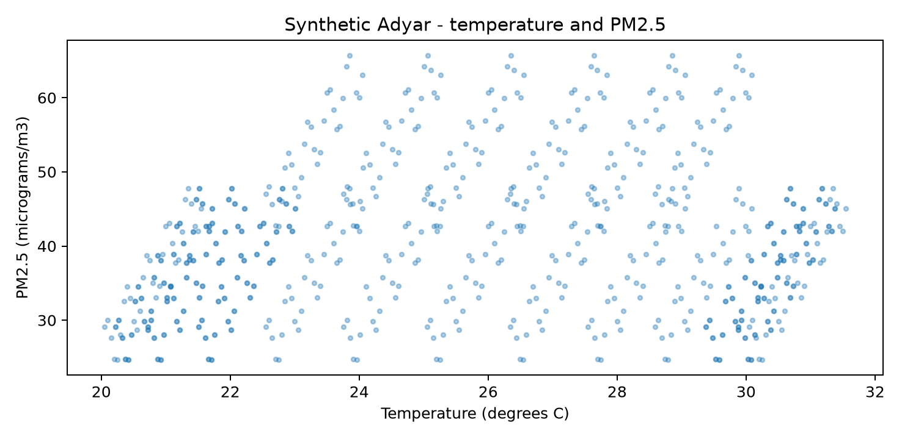
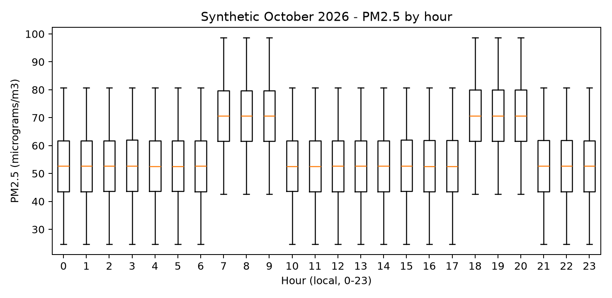

## Task B1 - Implement and validate the cleaning pipeline (7 marks)

### B1.1 Before/after evidence
TaskB1/small_messy.csv has 21 records. Its first record is Adyar,2026-10-01,0,48,80,15,30,C; the second uses aDyAr with surrounding spaces and a lowercase unit; the third is Guindy at 86 F; the fourth is King's Park. The remaining 17 records deliberately introduce each row-level fault listed in A1.1. The original rows, accepted rows and full rejection messages are preserved in small_before_after.json, and small_cleaned.csv is directly inspectable.

Accepted records after canonicalisation and conversion:

| Station | Date/hour | PM2.5 | PM10 | NO | Celsius |
| --- | --- | --- | --- | --- | --- |
| Adyar | 2026-10-01/0 | 48.00 | 80.00 | 15.00 | 30.00 |
| Adyar | 2026-10-01/1 | 60.00 | 90.00 | 20.00 | 31.00 |
| Guindy | 2026-10-01/0 | 95.00 | 150.00 | 25.00 | 30.00 |
| King's Park | 2026-10-01/0 | 40.00 | 70.00 | 10.00 | 29.00 |

Rejected records (line numbers include the header):

| CSV line | Reason |
| --- | --- |
| 6 | missing pm25 |
| 7 | missing pm10 |
| 8 | no outside 0..999 |
| 9 | pm25 outside 0..999 |
| 10 | could not convert string to float: 'broken' |
| 11 | non-finite pm25 |
| 12 | non-finite pm25 |
| 13 | temperature outside -50..60 C |
| 14 | day is out of range for month |
| 15 | Invalid isoformat string: '01/10/2026' |
| 16 | hour outside 0..23 |
| 17 | hour must be an integer |
| 18 | unknown or empty station |
| 19 | temperature unit disagrees with station metadata |
| 20 | duplicate station/day/hour; first valid row retained |
| 21 | wrong number of columns |
| 22 | wrong number of columns |

All 17 faulty records are rejected; all four expected valid records are retained. Checks also cover empty/constant scaling, exact Fahrenheit conversion, a case-normalised station, and z-score mean approximately zero. For accepted PM2.5 values [48,60,95,40], min-max gives approximately [0.145455,0.363636,1.000000,0.000000]. The normalisation functions preserve full precision; display rounding is separate.

### B1.2 Implementation compared with the design
The design's complete-case rejection, source-order duplicate policy, trusted station units and separate rejection ledger are implemented without changing their meaning. The file reader uses UTF-8 with optional BOM support; a broken header, CSV quoting or encoding fails the entire acquisition call instead of returning a silently partial file. The small script retains rows and errors in memory to make the evidence reviewable, so its memory is O(n); a production implementation should write batches and stream its error ledger.

The specified Complete the Code exercise is deliberately separate: it has only station/date/pm25 columns and filters valid non-negative PM2.5. Its TODO regions are filled, the original example output matches, and the required above-999 assertion uses an added 1000 test row. It does not pretend to be the full eight-column production validator.

```text
[('Adyar', '2026-10-01', 48.0), ('Guindy', '2026-10-01', 95.0), ('Guindy', '2026-10-03', 121.0)]
[0.0, 0.644, 1.0]
Above-999 row skipped: PASS
```

### B1.3 Store and query
The monthly generator creates 8,928 hourly observations for 12 stations over 31 days. Forty-eight contain missing PM2.5; 8,880 are accepted. The database contains 372 station/day summaries with 23 or 24 accepted readings per day. The stored units and checks follow A1, and executemany inserts all accepted records in a transaction.

The three implemented SQL questions are:

```sql
SELECT AVG(pm25), COUNT(*) FROM readings
WHERE station = ? AND day >= ? AND day < ?;

SELECT station, AVG(pm25), COUNT(*) FROM readings
WHERE day >= ? AND day < ?
GROUP BY station ORDER BY AVG(pm25) DESC;

SELECT hour, AVG(pm25), COUNT(*) FROM readings
WHERE day >= ? AND day < ?
GROUP BY hour ORDER BY AVG(pm25) DESC, hour LIMIT 5;
```

Bind Adyar/2026-10-01/2026-11-01 for question 1 and the same two date bounds for questions 2 and 3. Adyar's monthly mean is 40.6632 micrograms/m3 over 740 readings. The station comparison is:

| Station | October mean PM2.5 | Valid readings |
| --- | --- | --- |
| King's Park | 73.6489 | 740 |
| Porur | 70.6692 | 740 |
| Tambaram | 67.6692 | 740 |
| Mylapore | 64.6692 | 740 |
| Royapuram | 61.6692 | 740 |
| Perambur | 58.6692 | 740 |
| Ambattur | 55.6875 | 740 |
| Anna Nagar | 52.6875 | 740 |
| T Nagar | 49.6632 | 740 |
| Velachery | 46.6389 | 740 |
| Guindy | 43.6389 | 740 |
| Adyar | 40.6632 | 740 |

The top five mean hours are 20, 19, 8, 18 and 7, respectively, with means 70.6963, 70.6801, 70.6746, 70.6639 and 70.6584 micrograms/m3. Every one has 370 valid observations across stations/days. The tiny ranking differences reflect the deterministic missing-value pattern; hour 9 also belongs to the generator's high-reading band.

### B1.4 Four charts and interpretation


Adyar's daily mean rises from 33.57 on October 1 to 49.58 on October 31, with intermediate oscillations. Guindy follows a similar shape at a higher level because both share the same synthetic time pattern; this is evidence that the plotting pipeline works, not a discovery about the real city.



King's Park has the largest synthetic monthly mean (73.6489), and Adyar the smallest (40.6632). Every station has 740 valid readings, so coverage is equal in this fixture; a real comparison should inspect unequal coverage and missing-data patterns before ranking stations.



The scatter contains broad bands and substantial PM2.5 variation at similar temperatures. Both variables are generated from time-related formulas; the chart supports neither a simple causal relationship nor a claim that temperature alone predicts pollution.



The distributions at hours 7-9 and 18-20 are shifted upward relative to other hours, matching the generator's 18-unit addition. Overlapping boxes show substantial variation across dates and stations, so a worst-hour ranking of means does not describe every individual reading.

### Alternative: csv loops versus pandas
The timed comparison isolates the exercise's PM2.5 column cleaning and min-max scaling on identical generated three-column files. Each file includes 10% NA, 10% blank, 10% negative, 10% above 999 and 60% valid readings; both methods agree on valid count, sum and normalized sum. Full date/unit/duplicate validation is outside this microbenchmark, so these times are not claimed as timings of every B1 rule.

The loop reads csv.DictReader rows, filters and stores floats, then scales them. pandas read_csv, replace, to_numeric, dropna, between and vectorised arithmetic perform the equivalent operations. Both are O(n) time and O(n) retained-data memory; pandas uses additional arrays/masks and DataFrame storage. Chunked pandas or streamed batches would change the memory model, but were not benchmarked.

| Rows | csv loop ms | pandas ms | Loop peak MiB | pandas peak MiB |
| --- | --- | --- | --- | --- |
| 1000 | 0.506 | 1.859 | 28.6 | 72.8 |
| 100000 | 46.622 | 24.672 | 32.6 | 89.6 |
| 1000000 | 471.518 | 230.022 | 75.9 | 208.5 |

The values are three-run medians in milliseconds; memory is the maximum process peak RSS across the runs in MiB. Each trial runs in a fresh process. Imports are excluded from elapsed time, while RSS includes interpreter and imported libraries; peak RSS is not just the DataFrame's byte size and is platform-specific. Files are likely warm in the operating-system cache. pandas is slower for 1,000 rows because its setup costs dominate, but approximately twice as fast at one million rows while using substantially more process memory. All raw runs are in cleaning_benchmarks.json.

## Task B2 - Engineer adversarial data (5 marks)

### File and SQL challenges
The files in TaskB2/inputs are deliberately constructed, then passed through the same clean_file entry point. The program raises SourceError with an explicit cause; the caller records the failure and can continue to a different source. A bad file is not reported as a successful zero-reading day.

| Input | Observed outcome |
| --- | --- |
| empty.csv | expected exact comma-separated header: station,date,hour,pm25,pm10,no,temperature,temp_unit |
| latin1.csv | UnicodeDecodeError: 'utf-8' codec can't decode byte 0xe1 in position 56: invalid continuation byte |
| missing_column.csv | expected exact comma-separated header: station,date,hour,pm25,pm10,no,temperature,temp_unit |
| unclosed_quote.csv | Error: unexpected end of data |
| wrong_delimiter.csv | expected exact comma-separated header: station,date,hour,pm25,pm10,no,temperature,temp_unit |

The missing-column and delimiter tests show why an explicit schema contract is necessary. The encoding test shows that decoding is part of acquisition, not an incidental display choice; a production adapter can accept a documented alternate encoding, but automatic guessing could corrupt names. The empty-file test distinguishes missing observations from actual zero pollution. The unclosed-quote test shows that structural CSV corruption is a file-level failure.

A legitimate station called King's Park illustrates the quoting problem. Concatenation builds WHERE station='King's Park', and SQLite raises OperationalError near s. A placeholder query with that exact station string returns 40.0. Parameter binding lets an apostrophe remain data.

For Adyar' OR '1'='1, string concatenation changes the WHERE clause into a tautology and the unsafe AVG query returns 61.0, the average of all three test stations (48,95,40). Binding the same text with ? searches for that complete literal name, which does not exist, so AVG returns SQL NULL, exposed as Python None. This is not an error and it is not zero. The result is one aggregate row, rather than every raw row; a SELECT * version of the unsafe query would reveal all matching raw rows.

The assignment's separate four-row Complete the Code program produces exactly:

```text
54.0 108.0
None
```

Use placeholders for values, never string interpolation, even when an input looks like a station. Identifier choices such as table or column names require a fixed allowlist because ordinary value placeholders cannot substitute arbitrary SQL syntax. The queries here use fixed identifiers.

### Sentiment adversaries
The four explicit probes are recorded in evidence.json. 'Good, another smoke-filled evening.' scores neutral although the intended sarcastic complaint is negative. 'The road is not not clean.' scores negative, missing the double-negation positive reading. 'Clean park, dirty road.' is neutral and agrees with the balanced mixed reference. 'Helpful staff, broken sensor; overall dissatisfied.' is neutral although the final opinion is negative. These cases expose missing discourse understanding, a one-token negation scope, and a limited lexicon; adding more positive words alone does not solve them.

### Alternative: execute in a loop versus executemany
Both insert n rows and are O(n) time in the unindexed in-memory test; both use a single transaction and a commit after all rows. executemany reduces repeated Python-to-SQL call overhead. With maintained B-tree indexes, insertion can include O(log n) index work per row, and disk/transaction policy can dominate constants. A commit per row would be a different, unfair benchmark.

For 100,000 identical input rows, five-run medians were 33.409 ms for execute in a loop and 18.555 ms for executemany. Both databases were verified to have count 100,000 and PM2.5 sum 24,950,000. The prebuilt input list is O(n); a generator can feed either method with O(1) extra input state, apart from database/cache storage.

### Debug-output experiment supporting A4
For 10,000 calls, median buffered print time was 1.367 ms, disabled debug logging 0.546 ms, and enabled buffered debug logging 21.919 ms. Enabled logging has record construction and formatting overhead; its benefit is controllability and structured severity, not a universal speed advantage. These timeit trials use StringIO and deliberately exclude terminal rendering and disk latency. Logs grow with output bytes; disabled logging avoids building the output buffer.

## Task B3 - Loops versus libraries versus SQL (8 marks)

### B3.1 Correctness and data generation
The generator creates 365 days x 24 hours for 1, 12 and 120 synthetic stations. Station S001 uses index 0. Its hourly PM2.5 formula is 20 + station_index + (day_index MOD 31) + hour/10. Therefore the independent expected daily mean is 20 + station_index + (day_index MOD 31) + 1.15, because the mean of hours 0..23 is 11.5.

The plain baseline collects one list per station/day and calls statistics.mean. The running alternative accumulates a sum and count per key. pandas reads the same CSV and uses groupby(['station','day']).pm25.mean(); SQLite reads a previously loaded database and uses SELECT station,day,AVG(pm25) FROM aq GROUP BY station,day. The small 8,760-row case compares every key/value pair between all four methods. At every size and every repetition, all returned means are also checked against the independent formula, and group counts must be stations x 365. All checks passed, including 43,800 groups at 1,051,200 rows.

### B3.2 Measured time and memory
| Stations | Rows | Lists ms | Running ms | pandas ms | SQL query ms | SQL load ms |
| --- | --- | --- | --- | --- | --- | --- |
| 1 | 8,760 | 6.841 | 4.974 | 2.840 | 1.513 | 10.154 |
| 12 | 105,120 | 80.788 | 59.698 | 15.891 | 20.251 | 84.240 |
| 120 | 1,051,200 | 810.374 | 610.721 | 150.563 | 225.650 | 849.702 |

Three independent process trials produce each method median. CSV methods include reading/parsing plus grouping; SQL query timing includes connection, query and result materialisation but excludes initial CSV loading. The separately shown SQL load is one measured parse/batch-insert/commit run, not a three-run median. Add it when comparing one-time end-to-end acquisition; at the largest size the load-plus-query cost is approximately 1.075 seconds. Pre-importing pandas excludes import startup from its time. These boundaries matter more than declaring a library universally fastest.

| Rows | Lists MiB | Running MiB | pandas MiB | SQL MiB |
| --- | --- | --- | --- | --- |
| 8,760 | 28.8 | 28.6 | 78.7 | 29.6 |
| 105,120 | 33.6 | 29.8 | 92.0 | 34.2 |
| 1,051,200 | 86.8 | 48.7 | 198.8 | 46.9 |

Peak RSS includes runtime/import overhead and returned results. At 1,051,200 rows, the running dictionary used approximately 48.7 MiB versus 86.8 MiB for lists and 198.8 MiB for pandas. SQLite process RSS was 46.9 MiB, but its database and temporary storage consume disk space as well; RSS does not measure total storage.

### B3.3 cProfile evidence
The largest plain-Python case produced 13,601,833 function calls in about 1.998 profiled seconds. The top-level mean_lists function has that entire cumulative time; among its hot children csv.DictReader.__next__ takes about 0.849 cumulative seconds and 0.498 internal seconds, while statistics.mean accounts for about 0.837 cumulative seconds. The CSV iterator is the largest internal-time function in this run. Exact-ratio and fraction work under statistics.mean contributes to the aggregation cost.

Profile instrumentation makes the run slower than the unprofiled 0.810-second median, so the profile time is diagnostic evidence, not another directly comparable benchmark. The full cumulative and internal rankings are saved in profile.txt. Replacing per-group lists/statistics.mean with sum/count avoids retaining every float and avoids some exact-arithmetic overhead, while tolerance-based comparison accounts for floating-point summation differences.

### B3.4 Engineering choice and complexity
For a one-time analysis of a moderately sized CSV already fitting memory, pandas is concise and was fastest among these CSV methods. For an automated daily report, ingest each file once into the validated SQLite store and query only the relevant period; repeatedly reparsing the complete history wastes work and complicates consistency. On an environment without pandas or with a strict memory budget, the running dictionary is an effective standard-library fallback.

The list and running algorithms are both expected O(n) time. Lists store O(n) values plus O(g) keys; running sums/counts store O(g), where g = stations x observed days. pandas retains O(n) data plus grouping structures. SQL grouping has plan-dependent sort/index costs and can use temporary disk storage. For this fixed 24-readings-per-group generator, g = n/24, so both n and g grow with the station count: the memory improvement is a real constant reduction here, not evidence of constant memory as the network grows. If the number of observations per fixed group rises, the running-state advantage becomes stronger.

```text
ALGORITHM RUNNING_MEANS
INPUT: CSV readings
OUTPUT: station/day means
BEGIN
    INITIALISE group dictionary
    FOR EACH reading DO
        SET key TO station and day
        INITIALISE sum/count for key if absent
        ADD PM2.5 TO sum
        INCREMENT count
    ENDFOR
    FOR EACH key DO
        OUTPUT key and sum / count
    ENDFOR
END
```

## Task B4 - Final engineering decision (5 marks)

### B4.1 Practical sentiment, summary and chatbot
TaskB4/complaints.json contains 50 distinct, multi-sentence synthetic complaints. Before running the scorer, an illustrative reference sentiment and salient-sentence position were specified for each. These are illustrative reference judgements, not an independently annotated benchmark. The student must perform the requested own-reading comparison; personal_review.csv provides blank columns for that work without inventing answers.

The implemented lexicon agrees with 31/50 illustrative labels (62%). Frequency-based one-sentence summaries select the nominated salient sentence in 11/50 cases (22%), compared with 7/50 (14%) for the first sentence. This strict exact-sentence measure penalises equally reasonable alternate sentences and is not a complete semantic quality metric. Even so, the low figures reveal that both baselines miss context and cannot be trusted as autonomous complaint triage.

The following table makes every comparison auditable. Key-sentence positions are one-based here; JSON stores zero-based indices. The full texts, predicted scores and both generated summaries are in evaluation.json.

| ID | Reference | Prediction | Agree | Key sentence | Freq hit | First hit |
| --- | --- | --- | --- | --- | --- | --- |
| 1 | positive | positive | Yes | 2 | No | No |
| 2 | positive | positive | Yes | 2 | No | No |
| 3 | positive | positive | Yes | 2 | No | No |
| 4 | positive | positive | Yes | 2 | No | No |
| 5 | positive | positive | Yes | 1 | Yes | Yes |
| 6 | negative | negative | Yes | 2 | No | No |
| 7 | negative | negative | Yes | 2 | No | No |
| 8 | negative | negative | Yes | 2 | No | No |
| 9 | negative | negative | Yes | 2 | No | No |
| 10 | negative | negative | Yes | 2 | No | No |
| 11 | negative | negative | Yes | 1 | Yes | Yes |
| 12 | negative | negative | Yes | 2 | No | No |
| 13 | negative | negative | Yes | 1 | Yes | Yes |
| 14 | negative | negative | Yes | 2 | No | No |
| 15 | negative | negative | Yes | 2 | No | No |
| 16 | positive | positive | Yes | 1 | Yes | Yes |
| 17 | positive | positive | Yes | 1 | Yes | Yes |
| 18 | positive | positive | Yes | 1 | Yes | Yes |
| 19 | positive | positive | Yes | 2 | No | No |
| 20 | positive | positive | Yes | 2 | No | No |
| 21 | neutral | neutral | Yes | 2 | No | No |
| 22 | neutral | neutral | Yes | 2 | No | No |
| 23 | neutral | neutral | Yes | 2 | No | No |
| 24 | neutral | neutral | Yes | 2 | No | No |
| 25 | neutral | neutral | Yes | 2 | No | No |
| 26 | negative | negative | Yes | 2 | Yes | No |
| 27 | negative | negative | Yes | 2 | Yes | No |
| 28 | negative | negative | Yes | 2 | Yes | No |
| 29 | negative | positive | No | 2 | No | No |
| 30 | negative | positive | No | 1 | No | Yes |
| 31 | positive | negative | No | 2 | No | No |
| 32 | negative | positive | No | 2 | No | No |
| 33 | positive | negative | No | 2 | Yes | No |
| 34 | positive | negative | No | 2 | No | No |
| 35 | negative | positive | No | 2 | No | No |
| 36 | negative | positive | No | 3 | No | No |
| 37 | positive | neutral | No | 3 | No | No |
| 38 | neutral | neutral | Yes | 3 | No | No |
| 39 | negative | neutral | No | 3 | No | No |
| 40 | positive | neutral | No | 3 | No | No |
| 41 | positive | neutral | No | 2 | No | No |
| 42 | negative | neutral | No | 2 | No | No |
| 43 | positive | neutral | No | 2 | No | No |
| 44 | negative | neutral | No | 2 | No | No |
| 45 | negative | neutral | No | 2 | No | No |
| 46 | negative | positive | No | 2 | No | No |
| 47 | negative | positive | No | 2 | Yes | No |
| 48 | positive | positive | Yes | 2 | No | No |
| 49 | positive | negative | No | 2 | No | No |
| 50 | positive | positive | Yes | 2 | No | No |

For example, 'Such helpful staff, they ignored every call' can score positively because helpful is in the lexicon and ignored is not. 'The lane is not not clean' illustrates double-negation failure. 'The old service was bad but the current service is good' cancels to neutral, missing that the later clause and conclusion express satisfaction. The baseline's three possible labels also cannot distinguish factual neutral text from a mixture of strong positive and negative aspects.

The completed exercise preserves its given tokenisation and produces:

```text
positive | Roads are clean and the bus was fast.
negative | Smoke from the factory, air is bad.
negative | The staff were not helpful.
positive | Not bad, service improved.
```

The practical chatbot passes eight tests: valid Adyar, quoted station name, missing readings, two stations, unknown station, invalid calendar date, unsupported intent and absent date. A fixed test clock makes today mean 2026-10-01; the saved answer is a synthetic daily mean with its count, not a live reading. Its answer is checked against an independent sum/count query, and an extractive-summary check verifies that the returned sentence occurs in the original complaint.

### B4.2 Index the database and measure the slowest query
The controlled test uses B3's 1,051,200-row unindexed aq table copied to a separate experiment database. It measures the three A1-style query shapes, records EXPLAIN QUERY PLAN, chooses the slowest baseline by its median, then adds CREATE INDEX idx_station_day ON aq(station,day). Seven warm-query trials are saved for each before/after case. Result equivalence is checked to a floating-point tolerance.

| Query | Before ms | After ms | Before / after |
| --- | --- | --- | --- |
| station_month | 19.9305 | 0.0283 | 703.41x |
| station_comparison | 31.8970 | 28.8034 | 1.11x |
| worst_hours | 32.0026 | 32.4056 | 0.99x |

The baseline slowest query was worst_hours, at about 32.003 ms; after indexing it took 32.406 ms. That is effectively unchanged at this measurement precision, with a small run-to-run variation rather than a demonstrated improvement. It filters only on date and groups by hour, so a station-leading index does not provide a selective station range. The station/month query improved greatly because it can search station equality followed by a day interval; the full-city station comparison improves only modestly. Index construction took 0.196199 seconds, and indexes also occupy disk and add write cost.

This is deliberately a heap-table experiment. B1's PRIMARY KEY (station, day, hour) already creates an index with the required prefix; adding another (station, day) index there would normally duplicate useful access ordering. For the city-wide report, test a date-leading index such as (day, hour, pm25) or a maintained daily/hourly summary rather than assuming every index speeds every query. Those extra production candidates are recommendations for a follow-up workload test, not measured improvements in this report.

### B4.3 Decision at the expanded scale
If only the 100 added stations report every 15 minutes while the original 12 stay hourly, the network produces 100 x 96 + 12 x 24 = 9,888 readings/day, or 3,609,120 in a 365-day year. If all 112 stations switch to 15-minute intervals, it produces 10,752/day and 3,924,480/year. These are around 3.4-3.7 times the largest benchmark, but its timings should not be extrapolated as guaranteed latency: cache, disk, indexes and concurrency change.

Keep immutable raw CSVs plus checksum/provenance, stage and validate each incoming file, record rejected rows, then insert bounded batches transactionally. Replace the hour-only key with an unambiguous timestamp or day/minute slot; the existing hourly schema would wrongly collapse four quarter-hour readings. Track station timezone and schedule, distinguish late corrections from duplicates, and publish per-column coverage and quality flags. Apply validation before accepting data, and fit scaling parameters only on the relevant training/reference period.

SQLite is a practical starting point for this classroom-sized single-writer service and scheduled reports; monitor lock contention, backups, file growth and query latency. If concurrent writers or availability requirements grow, migrate the same validated schema to a server database. Query date ranges, retain station/time indexing, and maintain summary sum/count/min/max so repeated reports do not scan all history. Use pandas on selected extracts for exploratory analysis and matplotlib for labelled reports. The million-row measurements support this workflow, not an untested production capacity guarantee.

The 50-case medians were 0.1611 ms for sentiment, 0.2810 ms for frequency summaries and 0.0448 ms for first-sentence summaries. These short English fixtures show low computational cost; 50,000 monthly complaints are primarily a quality and oversight problem for this baseline. Do not route or dismiss complaints solely from a sentiment sign. Keep the simple scorer as an explainable demonstration, collect representative independently reviewed multilingual labels, evaluate a trained baseline on a held-out test set, and retain human review for uncertain or important cases.

### Alternative: first k sentences
If sentences are already stored in an array, selecting a fixed k sentence references is O(k), conventionally O(1) for fixed k. Producing the copied output still costs its character length. Starting from raw text, this implementation splits the entire complaint before slicing, so first_k is O(W) time/space in input words or characters, not O(1) end-to-end. A streaming implementation could stop after the kth sentence, costing the prefix length.

Frequency counting and sentence scoring cost O(W); the implemented sorting of S sentence scores adds O(S log S), and retained tokens/frequencies use O(W + V + S) space. A top-k heap could reduce selection to O(S log k), but is not used here. On the 50-complaint rubric, frequency improves exact salience matches by four cases, yet both methods remain poor: first sentences often introduce the topic while the actionable detail or overall judgement comes later. Repetition can also mislead the frequency method. The full paired summaries support inspection instead of a claim that frequency always gives better summaries.
